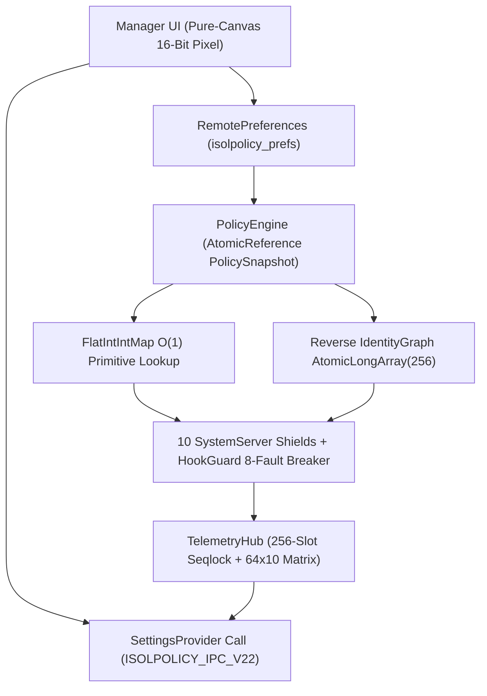
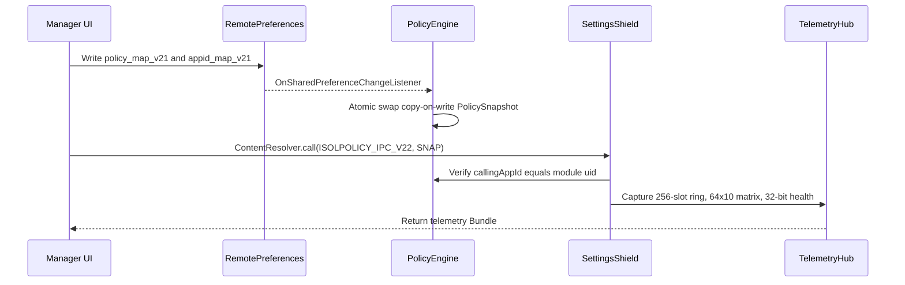

# IsolPolicy-Pro

Android `system_server` policy enforcement and telemetry module built on `libxposed:api:102.0.0` (LSPosed API 102) with a Pure-Canvas 16-bit Pixel UI. Derived from [MhmRdd/Isolation-Policy](https://github.com/MhmRdd/Isolation-Policy) under the Apache-2.0 license.

IsolPolicy operates exclusively inside `system_server` (`scope = system`, `staticScope = true`, `exceptionMode = protective`, `autoHotReload = false`). It does not inject into target application processes, does not spawn background daemons, and does not perform disk writes from `system_server`.

## Requirements and Scope

- Android 10 through Android 16 (API 29-36), AOSP and OEM ROMs
- Xposed framework implementing `libxposed:api:102.0.0` (e.g., LSPosed Vector API 102)
- Enabled scope: `System Framework` (`system`) only
- Target hardware baseline: 4 GB RAM, eMMC 5.1, non-GKI kernels (including Kernel 4.19 without SUSFS or APatch KPM)

### Explicit Non-Touch Boundaries

To maintain radio, networking, graphics, and filesystem stability, IsolPolicy never hooks or modifies:

- `ConnectivityService` (WiFi, 4G LTE Carrier Aggregation, and network tuning remain untouched)
- `/system/etc/hosts`, mount namespaces, or system binaries
- Primary display (`displayId == 0`) in `DisplayManagerService`
- `FLAG_SECURE`, `LocationManagerService`, `ClipboardService`, or `BiometricService`
- Client-local `SystemProperties` reads (e.g., `ActivityManager.isRunningInUserTestHarness()`)

## Architecture



### Hot-Reload and Authenticated Telemetry Flow



## 32-Bit Policy Word Layout

Bits `0..6` and `RemotePreferences` keys (`policy_map_v21`, `appid_map_v21`) remain binary-compatible with v2.0 and v2.1 configurations. Bits `7..10` extend the policy word for v2.2.0 (`ALL_SHIELDS_MASK = 0x7FF`).

| Bit(s) | Mask | Constant | Pillar(s) | Default | Description |
| :--- | :--- | :--- | :--- | :--- | :--- |
| `0..1` | `0x003` | `AZ_MASK` | P1 (`AZ`) | `0` (`OFF`) | AppZygote mode: `0=OFF`, `1=AUTO`, `2=DOWNGRADE`, `3=HARD_DROP` |
| `2` | `0x004` | `FLAG_ISO_FOLD` | P2 (`ISO`) | `0` (opt-in) | Fold eligible isolated services into owner process (6 safety gates) |
| `3` | `0x008` | `FLAG_DEV_COHERENT` | P3 (`SET`), P4 (`USB`) | `0` | DevOpts, ADB, Wireless ADB, Mock Location, Verifier, USB_STATE, UsbService |
| `4` | `0x010` | `FLAG_A11Y_COHERENT` | P5 (`A11Y`), P3 (`SET`) | `0` | AccessibilityManager Binder responses, push state, and coherent Settings.Secure keys |
| `5` | `0x020` | `FLAG_PKG_CHANGES` | P6 (`PKG`) | `0` | Suppress `getChangedPackages` and filter foreign `PackageInstaller` sessions |
| `6` | `0x040` | `FLAG_DISP_STEALTH` | P7 (`DISP`) | `0` | Hide secondary/virtual displays (`displayId != 0`) across polling and push callbacks |
| `7` | `0x080` | `FLAG_PROC_SURFACE` | P8 (`PROC`) | `0` (opt-in) | Filter sensitive `ApplicationExitInfo` reasons, `isUserAMonkey`, and error process list |
| `8` | `0x100` | `FLAG_INPUT_SURFACE` | P9 (`INP`) | `0` (opt-in) | Filter synthetic input injectors while preserving `-1` virtual keyboard and real hardware |
| `9` | `0x200` | `FLAG_OBS_COHERENCE` | P10 (`OBS`) | `0` (opt-in) | Suppress guarded Settings URI push notifications in `ContentService` |
| `10` | `0x400` | `FLAG_AUDIT_ONLY` | All 10 | `0` (opt-in) | Shadow dry-run mode: record matched vectors without mutating Binder arguments or returns |
| `11..31` | `0xFFFFF800` | Reserved | None | `0` | Masked to zero on encode; ignored on decode |

### Built-In Presets

| Preset | Hex Mask | Active Bits | Intended Use |
| :--- | :--- | :--- | :--- |
| `PRESET_NONE` | `0x000` | None | Disabled (`SANDBOX` apps always remain `0x000`) |
| `PRESET_WALLET_ALIPAY` | `0x03E` | `AZ:DOWN`, `ISO`, `DEV`, `A11Y`, `PKG` | Legacy v2.1 opt-in isolated-folding wallet profile |
| `PRESET_BANKING_STRICT` | `0x07A` | `AZ:DOWN`, `DEV`, `A11Y`, `PKG`, `DISP` | Standard financial profile (`ISO` off) |
| `PRESET_BANKING_MAX` | `0x3FA` | `AZ:DOWN`, `DEV`, `A11Y`, `PKG`, `DISP`, `PROC`, `INP`, `OBS` | Full 9-pillar enforcement (`ISO` off) |
| `PRESET_AUDIT_BANK` | `0x7FA` | `PRESET_BANKING_MAX` + `AUDIT` | Non-destructive dry-run profiling for new financial apps |
| `PRESET_AUDIT_MAX` | `0x7FE` | All 10 pillars + `AUDIT` | Full dry-run telemetry capture including `ISO` matches |

## 10-Pillar SystemServer Hook Matrix

All 10 pillars resolve policies via `PolicyEngine.resolvePolicy(callingUid)`. Fast-path `appId < 10000` bypasses in under 10 ns. Multi-user and Work Profile UIDs normalize via `uid % 100000`, and isolated process UIDs (`90000..99999`) map back to their owner `appId` through the Reverse IdentityGraph.

| No | Code | Shield Class | Target Class and Methods | API Range | Behavior and Guardrails |
| :--- | :--- | :--- | :--- | :--- | :--- |
| 1 | `AZ` | `AppZygoteShield` | `HostingRecord.byAppZygote`, `usesAppZygote`, `ProcessList.startProcessLocked`, `startProcess`, `removeProcessNameLocked` | 29-36 | Dynamic `APP_ZYGOTE` constant lookup; return-type guard (`boolean` vs `ProcessRecord`) on `HARD_DROP`; feeds and evicts Reverse IdentityGraph. |
| 2 | `ISO` | `IsolatedFoldShield` | `ActiveServices.bringUpServiceLocked` | 29-36 | Opt-in. Enforces 6 gates blocking external, WebView/Chromium, dynamic `instanceName`, and `AZ_OFF` mismatches; rolls back on throw. |
| 3 | `SET` | `SettingsShield` | `SettingsProvider.call` (`GET_*`, `LIST_*`), `SettingsProvider.query` (single and bulk) | 29-36 | Dual-checkpoint `onPackageLoaded` + `onPackageReady`. Sanitizes 17 DevOpts/ADB/WiFi-ADB/Mock/Verifier/A11y keys; omits `_generation_index` on single-key spoof; caps bulk scan at 512 rows. |
| 4 | `USB` | `UsbBroadcastShield` | `ActivityManagerService.registerReceiverWithFeature`/`registerReceiver`, `UsbService.getCurrentFunctions`, `getScreenUnlockedFunctions`, `isFunctionEnabled`, `AdbService.getAdbWirelessPort` | 29-36 | Clones sticky `ACTION_USB_STATE` without mutating `mStickyBroadcasts`; strips `FUNCTION_ADB` (`1L`); returns `0` for wireless ADB port. |
| 5 | `A11Y` | `AccessibilityShield` | `AccessibilityManagerService.addClient`, `getEnabled/InstalledAccessibilityServiceList`, `getAccessibilityShortcutTargets`, `IAccessibilityManagerClient$Stub$Proxy.setState` | 29-36 | Strips `0x1B` state bits; dynamic `List` vs `ParceledListSlice` empty return; bounded 512-entry client binder tracker. |
| 6 | `PKG` | `PackageSurfaceShield` | `IPackageManagerBase`/`PackageManagerService`/`ComputerEngine.getChangedPackages`, `PackageInstallerService.getAllSessions` | 29-36 | Returns `null` for `getChangedPackages`; filters `PackageInstaller.SessionInfo` slices to sessions owned by caller UID/package. |
| 7 | `DISP` | `DisplayShield` | `DisplayManagerService$BinderService.getDisplayIds`, `getDisplayInfo`, `CallbackRecord.notifyDisplayEventAsync` | 29-36 | Reverse IdentityGraph enabled (`allowIsolated=true`); `displayId == 0` untouched; dynamic `Boolean.TRUE` (API 34+) vs `null` (API 29-33) on push suppression. |
| 8 | `PROC` | `ProcessSurfaceShield` | `ActivityManagerService.getHistoricalProcessExitReasons`, `isUserAMonkey`, `getProcessesInErrorState` | 29-36 | Opt-in. Filters exit reasons `2`, `5`, `10`, `14` via reflection-safe `getReason()` (API 29 safe); returns `false` for monkey and `null` for error list. |
| 9 | `INP` | `InputSurfaceShield` | `InputManagerService.getInputDeviceIds`, `getInputDevice` | 29-36 | Opt-in. Unconditionally passes `id <= 0` (`VIRTUAL_KEYBOARD`), internal sensors (`uinput-fpc`, `goodix`, `gpio-keys`, touchscreen), and valid USB/BT VID/PID hardware; filters synthetic injectors. |
| 10 | `OBS` | `ObserverCoherenceShield` | `ContentService$ObserverCollector.collect` (API 30-36), `ContentService.registerContentObserver` (API 29 fallback) | 29-36 | Opt-in. Suppresses Settings URI push notifications for keys actively guarded by `SettingsShield`. |

## Engine Internals and Memory Budget

- **Hot-Path Lookup (`FlatIntIntMap`):** Copy-on-write immutable `PolicySnapshot` backed by primitive `int[] keys` and `int[] vals` (Fibonacci multiplier `0x9E3779B9`, power-of-two table, load factor < 0.5). Zero `Integer` boxing and zero heap allocation on Binder threads.
- **Tombstone-Safe Reverse IdentityGraph:** `AtomicLongArray(256)` packing `(isoUid << 32) | ownerAppId` (`> 0L`). `evictIsolatedUid()` writes sentinel `-1L` (`TOMBSTONE_SLOT`) rather than `0L`, preserving linear-probe chains across hash collisions while `registerIsolatedUid()` reuses the first tombstone slot without creating duplicates.
- **Fault Isolation (`HookGuard`):** Every hook callback tracks consecutive internal faults separately from exceptions thrown by `chain.proceed()`. After 8 consecutive internal faults, only the affected callback trips into zero-overhead pass-through (`HEALTH_TRIPPED`) and reports the fault in the 32-bit `HookHealthMask`.
- **Resident Memory Footprint in `system_server`:**

| Structure | Backing Representation | Static Size |
| :--- | :--- | :--- |
| Seqlock Ring Buffer (256 slots) | `long[256]`, `int[256]` x 2, `AtomicIntegerArray(256)` | ~5.1 KB |
| Per-App x Per-Pillar Matrix (64x10) | `AtomicLongArray(640)`, `AtomicIntegerArray(64)`, `AtomicLongArray(64)` | ~5.9 KB |
| Reverse IdentityGraph (256 slots) | `AtomicLongArray(256)` | ~2.0 KB |
| `FlatIntIntMap` Policy Snapshot | Primitive `int[]` pairs (power-of-two) | ~2-4 KB |
| Total Resident Overhead | Zero threads, zero disk writes | < 20 KB |

## Wire Formats and Authenticated IPC

- **RemotePreferences (`isolpolicy_prefs`, read-only in `system_server`):**
  - `policy_map_v21`: `pkg=flags;...`
  - `appid_map_v21`: `appId:flags:pkg;...`
  - `default_az_v21`: integer `0..3`
  - `self_app_id`: manager appId (`uid % 100000`)
- **IPC Channel (`ISOLPOLICY_IPC_V22`, backward-compatible with `ISOLPOLICY_IPC_V21`):**
  - Invoked via `ContentResolver.call(Settings.Global.CONTENT_URI, method, cmd, extras)`.
  - Caller `Binder.getCallingUid() % 100000` must equal `verifiedSelfAppId` obtained from `module.getModuleApplicationInfo().uid`. All other callers fall straight through to `chain.proceed()`.
  - Commands: `SNAP` (telemetry snapshot + host coherence probes), `PURGE` (reset ring buffer and hit counters), `PING` (version, API level, health mask).
- **JSON Backup (`PolicyCodec`):**
  - Standalone RFC-8259 parser (no `org.json` dependency, 2 MB max length, depth limit 16).
  - Exports `"schemaVersion": 22` with both integer `"flags"` and expanded boolean keys (`az`, `iso`, `dev`, `a11y`, `pkg`, `disp`, `proc`, `inp`, `obs`, `audit`). Imports v2.0 (`modes`/`targets`/`packages`), v2.1, and v2.2 files cleanly.

## Pure-Canvas 16-Bit Pixel UI

The manager UI consists of 19 allocation-free Pure-Canvas widgets in `ui.pixel` and 4 screen/adapter classes in `ui`, using only `androidx.recyclerview:recyclerview:1.4.0` as an external UI dependency.

- **6 WCAG-Verified Hardware Palettes:** `CRT PHOSPHOR`, `DMG PAPER`, `AMBER CRT`, `POCKET OLIVE`, `SLATE TOKYO`, and `SEPIA TERM` (every palette calibrated to >= 4.8:1 accent/audit/warn/danger contrast and >= 8.1:1 primary ink contrast).
- **Dual Raster Bitmap Font (`PixelFont`):** Full 95 printable ASCII `5x7` glyphs (packed into `long[95]`) plus a `3x5` micro atlas with horizontal run coalescing.
- **Sprites (`PixelSpriteAtlas`):** 16x16 adaptive status shield emblems, 14x14 dock icons, 10 unique 9x9 pillar icons, and 9x9 control icons.
- **4 Console Tabs:**
  - `GUARD`: Search, filter chips (`ALL`, `GUARD`, `AUDIT`, `FIN`, `SAFE`, `SYS`), safe finance batch actions (`AUTO BANK`, `AUDIT BANK`, `CLEAR` — `SANDBOX` apps exempt), uncluttered 6-keycap cards, and `AppInspectorDialog` with symmetric 2x5 10-pillar matrix, `SHADOW AUDIT DRY-RUN`, and per-app heatmap (`PixelAppHeatmapBar`).
  - `SCOPE`: 2-channel `PixelScopeView` (`ENFORCED` + `AUDIT` + peak caps), interactive 2x5 `PixelCounterStrip`, mode filter, `EXPORT` trace, `PURGE`, and 256-row trace log.
  - `RADAR`: Zero-extract ZIP Central Directory ELF SDK fingerprinting (`ALIPAY`, `VKEY`, `PROMON`, `APPSEAL`, `TMX`, `BANGCLE`, `JIAGU`, `ZIMPERIUM`, `ROOTBEER`, `HARDENED`) with strict separation of `FINANCE`, `GENERAL`, and `SANDBOX` (`SAFE OFF`).
  - `VAULT`: `PixelHealthMatrixView` (10 pillars status/tier/faults + `IPC`/`SET` checkpoints), `PixelCoherenceBarView` (`HOST` vs `GUARD` LEDs + `W-ADB` + `ID GRAPH`), 6-palette picker, `PIXEL-16`/`NATIVE` icon mode (4 MB `LruCache`), keycap haptic toggle, SAF/Clipboard JSON vault, and APK EC P-256 certificate SHA-256 viewer.

## Complementary Stack on Non-SUSFS Kernels

IsolPolicy hardens the Java/Binder `system_server` surface. On devices with non-GKI kernels lacking SUSFS, pair it orthogonally with:

- Zygote/mount hiding (e.g., ReZygisk + Treat Wheel + mountify)
- Package list isolation (e.g., HMA-OSS with IsolPolicy hidden from financial apps)
- Hardware attestation and vbmeta coherence (e.g., TrickyStore / AlwaysStrong Inject)

## Build, Testing, and Signing

```bash
./gradlew :app:testDebugUnitTest
./gradlew :app:assembleRelease :app:assembleDebug
```

GitHub Actions (`.github/workflows/build.yml`) enforces:

1. Zero orphan `.aidl` files and `aidl = false` in `app/build.gradle.kts`.
2. `keytool -list` verification on the decoded PKCS#12 keystore when persistent signing secrets (`SIGNING_KEYSTORE_B64`, `SIGNING_KEYSTORE_PASS`, `SIGNING_KEY_ALIAS`, `SIGNING_KEY_PASS`) are configured.
3. Execution of all 45 JUnit 4 JVM unit tests (`:app:testDebugUnitTest`).
4. Zero `*-unsigned.apk` outputs, release APK size <= 650 KB, and mandatory `apksigner verify --verbose --print-certs`.

## License

Apache License 2.0. See `LICENSE` for details.
