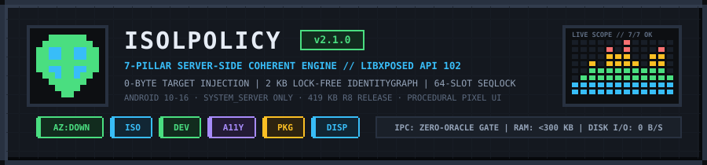

<picture>
  <source media="(prefers-color-scheme: dark)" srcset=".github/assets/banner-dark.svg" />
  <source media="(prefers-color-scheme: light)" srcset=".github/assets/banner-light.svg" />
  
</picture>

 

  
  
  
  
  
  
  

  <a href="#architectural-thesis">Architecture</a> &middot;
  <a href="#system-topology">Topology</a> &middot;
  <a href="#state-lifecycle">Lifecycle</a> &middot;
  <a href="#formal-specification">Math Spec</a> &middot;
  <a href="#seven-pillar-engine">7 Pillars</a> &middot;
  <a href="#polyglot-systems-internals">Polyglot Internals</a> &middot;
  <a href="#procedural-pixel-ui">Pixel UI</a> &middot;
  <a href="#ecosystem-synergy">Synergy</a> &middot;
  <a href="#build-and-verification">Verification</a>

> [!IMPORTANT]
> **Zero Target Process Footprint:** IsolPolicy v2.1.0 executes 100% inside `system_server` (`UID 1000`, `scope: system`, `autoHotReload=false`). Zero DEX classes, zero native `.so` hooks, and zero memory pages are injected into banking, e-wallet, or audit application processes.

## Architectural Thesis

Modern Android anti-tamper and financial security SDKs (Alipay `APSecuritySDK`, Promon SHIELD, V-Key `vGuard`, AppSealing, ThreatMetrix, and runtime audit engines) bypass naive userspace hiding through four structural invariants:

1. **AppZygote & Non-AppZygote Isolated Mount-Escape:** On non-GKI kernels lacking kernel-level mount filtering (such as Linux `4.19` without SUSFS), Zygisk userspace unmount sanitizes only the primary process namespace (`UID 10xxx`). Security SDKs spawn either an `AppZygote` service (`FLAG_USE_APP_ZYGOTE`, `UID 90000-98999`) or an internal isolated helper (`FLAG_ISOLATED_PROCESS`, `UID 99000-99999`) that inherits an uncleaned mount table directly from Zygote.
2. **Cross-API State Contradiction:** Returning `0` for `Settings.Global.adb_enabled` inside `SettingsProvider.call()` alone exposes immediate contradictions across `SettingsProvider.query()` (SQL cursor bypass), sticky broadcast `android.hardware.usb.action.USB_STATE` (`adb=true`), and `UsbService.getCurrentFunctions()` (`FUNCTION_ADB`). Similarly, spoofing `Settings.Secure.accessibility_enabled` fails while `AccessibilityManagerService.addClient()` returns the live 64-bit `IntPair` bitmask (`STATE_FLAG_ACCESSIBILITY_ENABLED = 0x1`) or pushes state updates over `IAccessibilityManagerClient.setState()`.
3. **Cache Poisoning & Lifecycle Races in `system_server`:** Returning AOSP `_track_generation` keys inside spoofed `SettingsProvider` bundles poisons shared `MemoryIntArray` caches globally. Meanwhile, `SettingsProvider.apk` loads into `system_server` via `LoadedApk` after `onSystemServerStarting`, causing single-callback hooks to miss attachment unless guarded across both `onPackageLoaded` and `onPackageReady`.
4. **Telemetry IPC Detection Oracles:** Custom IPC methods registered on system providers act as trivial detection beacons if unauthorized processes receive non-stock exceptions or custom error responses.

<table>
  <thead>
    <tr>
      <th>Architectural Axis</th>
      <th>Upstream v1.1 (API 82)</th>
      <th>IsolPolicy v2.0 (API 102)</th>
      <th>IsolPolicy v2.1.0 (API 102)</th>
    </tr>
  </thead>
  <tbody>
    <tr>
      <td><strong>Execution Boundary</strong></td>
      <td><code>system_server</code></td>
      <td><code>system_server</code> (0 B app inject)</td>
      <td><code>system_server</code> (0 B app inject, <code>autoHotReload=false</code>)</td>
    </tr>
    <tr>
      <td><strong>Isolation Control</strong></td>
      <td>Hard cancel (SELinux timeout)</td>
      <td>4-Layer AppZygote Silent Downgrade</td>
      <td>4-Layer AppZygote + 6-Guard Selective Isolated Folding</td>
    </tr>
    <tr>
      <td><strong>UID Attribution</strong></td>
      <td>Package name scan</td>
      <td><code>WeakHashMap</code> record tracking</td>
      <td>Lock-Free 2 KB <code>AtomicLongArray</code> Reverse <code>IdentityGraph</code></td>
    </tr>
    <tr>
      <td><strong>Cross-API Coherence</strong></td>
      <td>None</td>
      <td>None</td>
      <td><code>Settings.call+query</code>, Sticky <code>USB_STATE</code>, <code>UsbService</code>, <code>AMS.addClient+Push</code>, <code>getChangedPackages</code>, <code>DisplayManager</code></td>
    </tr>
    <tr>
      <td><strong>Telemetry Engine</strong></td>
      <td>Logcat</td>
      <td>Silent Release</td>
      <td>64-Slot Seqlock Ring Buffer + Zero-Oracle IPC Gate + 7-Bit Health Matrix</td>
    </tr>
    <tr>
      <td><strong>Static Threat Radar</strong></td>
      <td>None</td>
      <td>Binary AXML AppZygote Radar</td>
      <td>Binary AXML + Zero-Extract Native ELF Antifraud SDK Scanner</td>
    </tr>
    <tr>
      <td><strong>UI Architecture</strong></td>
      <td>Material / AppCompat</td>
      <td>~305 KB</td>
      <td>419 KB Procedural 16-Bit Pixel Canvas (Zero Compose/AppCompat/PNG)</td>
    </tr>
  </tbody>
</table>

## System Topology

~~~mermaid
flowchart TB
    UI[MainActivity Procedural Pixel Console]
    RADAR[ManifestRadar AXML and ELF Scanner]
    PREFS[(XposedService RemotePreferences)]
    ENGINE[PolicyEngine Lock-Free AtomicReference Snapshot]
    GRAPH[(IdentityGraph 256-Slot AtomicLongArray 2KB)]
    HUB[TelemetryHub 64-Slot Seqlock Ring Buffer]

    subgraph SYSSRV[system_server UID 1000 - Zero Target Process Injection]
        direction TB
        P1[Pillar 1 AppZygoteShield]
        P2[Pillar 2 IsolatedFoldShield]
        P3[Pillar 3 SettingsShield Call and Query]
        P4[Pillar 4 UsbBroadcastShield]
        P5[Pillar 5 AccessibilityShield]
        P6[Pillar 6 PackageChangeShield]
        P7[Pillar 7 DisplayShield]
        GATE{Zero-Oracle IPC Gate}
    end

    UI -->|Write Bitmask and AppId Map| PREFS
    RADAR -->|Threat Vector and Preset| UI
    PREFS -->|Read-Only Change Listener| ENGINE
    P1 -->|Register Isolated to Owner UID| GRAPH
    GRAPH -->|O1 Owner AppId Lookup| ENGINE
    ENGINE --> P1
    ENGINE --> P2
    ENGINE --> P3
    ENGINE --> P4
    ENGINE --> P5
    ENGINE --> P6
    ENGINE --> P7
    P1 --> HUB
    P2 --> HUB
    P3 --> HUB
    P4 --> HUB
    P5 --> HUB
    P6 --> HUB
    P7 --> HUB
    P3 --> GATE
    GATE -->|Verified Self AppId| HUB
    HUB -->|Compact Primitive Bundle| UI
    GATE -->|Any Unauthorized UID| STOCK[Stock AOSP chain.proceed]
~~~

## Coherent Interception Sequence

~~~mermaid
sequenceDiagram
    participant App as Guarded Financial App
    participant AM as ActivityManager and ActiveServices
    participant Graph as PolicyEngine and IdentityGraph
    participant SP as SettingsProvider and AMS and DMS
    participant Hub as TelemetryHub Ring Buffer
    participant UI as IsolPolicy Pixel Console

    App->>AM: bindService with useAppZygote or isolatedProcess
    AM->>Graph: Lookup 32-bit PolicyFlags by AppId or Package
    alt AppZygote Service and AZ_DOWNGRADE
        AM->>AM: Clear mHostingZygote to REGULAR_ZYGOTE across ProcessStart thread
        AM->>Hub: Record PILLAR_APP_ZYGOTE ACT_DOWNGRADED
    else Internal Isolated Service and FLAG_ISO_FOLD
        AM->>AM: Verify 6 WebView safety guards then clear FLAG_ISOLATED_PROCESS
        AM->>Hub: Record PILLAR_ISO_FOLD ACT_FOLDED
    else Isolated Process Permitted
        AM->>Graph: Atomic pack isoUid and ownerAppId into AtomicLongArray
    end

    App->>SP: Query Settings.Global call and SQL cursor
    SP->>Graph: Resolve effective ownerAppId from callingUid
    SP-->>App: Single-key Bundle without _track_generation and sanitized MatrixCursor
    SP->>Hub: Record PILLAR_SETTINGS ACT_SPOOFED

    App->>SP: registerReceiverWithFeature ACTION_USB_STATE
    SP-->>App: Cloned sticky Intent with adb false preserving MTP
    SP->>Hub: Record PILLAR_USB ACT_SANITIZED

    App->>SP: AccessibilityManagerService addClient and getEnabledList
    SP-->>App: IntPair state cleared of A11y flags and empty service list
    SP->>Hub: Record PILLAR_A11Y ACT_SANITIZED

    App->>SP: Probe ISOLPOLICY_IPC_V21 from unauthorized UID
    SP-->>App: Stock AOSP chain.proceed response with zero oracle

    UI->>SP: Call ISOLPOLICY_IPC_V21 from verified selfAppId
    SP->>Hub: Read tear-free seqlock 64-slot ring buffer
    SP-->>UI: Live counters and 7-bit hook health matrix
~~~

## State Lifecycle

~~~mermaid
stateDiagram-v2
    [*] --> ModuleLoaded: Zygote forks system_server
    ModuleLoaded --> Detached: Non-system_server process
    Detached --> [*]
    ModuleLoaded --> SystemServerInit: isSystemServer true
    SystemServerInit --> CoreHooksReady: Install Pillars 1 2 4 5 6 7
    CoreHooksReady --> SettingsCheckpoint1: onPackageLoaded settings
    CoreHooksReady --> SettingsCheckpoint2: onPackageReady settings
    SettingsCheckpoint1 --> AllSevenActive: AtomicBoolean attached CAS true
    SettingsCheckpoint2 --> AllSevenActive: Idempotent guard verified
    AllSevenActive --> SnapshotSwap: RemotePreferences live edit 0ms
    SnapshotSwap --> AllSevenActive: Lock-free AtomicReference replace
~~~

## Formal Specification

### 1. Compact 32-Bit Per-Package Policy Encoding

Every target application policy is packed into a single 32-bit integer $\Phi_u \in [0, 127]$ inside an immutable copy-on-write `SparseIntArray`:

$$\Phi_u = m_{\mathrm{AZ}} + 2^{2} f_{\mathrm{ISO}} + 2^{3} f_{\mathrm{DEV}} + 2^{4} f_{\mathrm{A11Y}} + 2^{5} f_{\mathrm{PKG}} + 2^{6} f_{\mathrm{DISP}}$$

$$m_{\mathrm{AZ}} \in \{0, 1, 2, 3\} \equiv \{\text{OFF}, \text{AUTO}, \text{DOWNGRADE}, \text{HARD-DROP}\}$$

$$f_k \in \{0, 1\}, \quad k \in \{\mathrm{ISO}, \mathrm{DEV}, \mathrm{A11Y}, \mathrm{PKG}, \mathrm{DISP}\}$$

### 2. Hardware-Atomic Reverse `IdentityGraph`

Incoming Binder UID $u$ bypasses all system UIDs ($a(u) \lt 10000$) in one comparison and resolves isolated/AppZygote UIDs ($a(u) \ge 90000$) via Fibonacci multiplicative hashing over a fixed 256-slot `AtomicLongArray`:

$$a(u) = u \bmod 100000$$

$$w(u) = (u \cdot \mathrm{0x9E3779B9}) \bmod 2^{32}$$

$$h(u) = \left(w(u) \oplus \left\lfloor \frac{w(u)}{2^{16}} \right\rfloor\right) \bmod 256$$

$$E_i = \left(u_{\mathrm{iso}} \cdot 2^{32}\right) + a_{\mathrm{owner}}$$

$$\mathrm{Mem}(\mathcal{G}) = 256 \times 8\,\mathrm{B} = 2048\,\mathrm{B}, \qquad T_{\mathrm{lookup}} = \mathcal{O}(1)$$

### 3. Coherent `AccessibilityManagerService.addClient()` Projection

AOSP packs client state flags and relevant event masks into a 64-bit `IntPair` return word $R_{\mathrm{raw}}$. IsolPolicy clears active accessibility state bits ($M_{\mathrm{clear}} = \mathrm{0x1B}$) while preserving unrelated event bits:

$$R_{\mathrm{raw}} = \left(S_{\mathrm{state}} \cdot 2^{32}\right) + E_{\mathrm{events}}$$

$$M_{\mathrm{clear}} = 2^{0} + 2^{1} + 2^{3} + 2^{4} = \mathrm{0x1B}$$

$$S_{\mathrm{clean}} = \sum_{b \in \{0..31\} \setminus \{0,1,3,4\}} s_b \cdot 2^{b}$$

$$R_{\mathrm{out}} = \left(S_{\mathrm{clean}} \cdot 2^{32}\right) + E_{\mathrm{events}}$$

### 4. Deterministic Static Threat Score

`ManifestRadar` evaluates an offline severity vector $\mathcal{R}(p) \in [0, 100]$ from Binary AXML parsing and zero-extract ZIP Central Directory inspection:

$$\mathcal{R}(p) = \min\left(100,\, 45 \cdot \mathbf{1}_{\mathrm{AZ}} + 25 \cdot \mathbf{1}_{\mathrm{ISO}} + \min\left(35,\, 20 \cdot |\mathcal{S}_{\mathrm{ELF}}|\right) + 10 \cdot \mathbf{1}_{\mathrm{QAP}} + 15 \cdot \mathbf{1}_{\mathrm{FIN}}\right)$$

## Seven-Pillar Engine

<table>
  <thead>
    <tr>
      <th>Pillar</th>
      <th>Class</th>
      <th>AOSP Target Class &amp; Methods</th>
      <th>Coherent Invariant &amp; Safety Guard</th>
    </tr>
  </thead>
  <tbody>
    <tr>
      <td><strong>1. AppZygote</strong></td>
      <td><code>AppZygoteShield</code></td>
      <td><code>HostingRecord.byAppZygote</code>, <code>usesAppZygote</code>, <code>ProcessList.startProcessLocked</code>, <code>startProcess</code>, <code>removeProcessNameLocked</code></td>
      <td>4-layer cross-thread Silent Downgrade (<code>mHostingZygote = 0</code>) or Hard Drop + live <code>IdentityGraph</code> registration/eviction + <code>module.deoptimize()</code>.</td>
    </tr>
    <tr>
      <td><strong>2. Isolated Fold</strong></td>
      <td><code>IsolatedFoldShield</code></td>
      <td><code>ActiveServices.bringUpServiceLocked</code></td>
      <td>Opt-in folding of internal <code>FLAG_ISOLATED_PROCESS</code> helpers into clean main UID <code>10xxx</code>. Strictly protects <code>FLAG_EXTERNAL_SERVICE</code>, <code>FLAG_USE_APP_ZYGOTE</code>, dynamic <code>bindIsolatedService</code>, and WebView/Chrome packages.</td>
    </tr>
    <tr>
      <td><strong>3. Settings &amp; IPC</strong></td>
      <td><code>SettingsShield</code></td>
      <td><code>SettingsProvider.call</code>, <code>SettingsProvider.query</code> (Dual-Checkpoint <code>onPackageLoaded</code> + <code>onPackageReady</code>)</td>
      <td>Spoofs <code>GET_global</code> (Dev/ADB/Debug) and <code>GET_secure</code> (A11y/Mock) returning a single-key <code>Bundle</code> without <code>_track_generation</code> + SQL <code>MatrixCursor</code> sanitizer + Zero-Oracle IPC Gate.</td>
    </tr>
    <tr>
      <td><strong>4. USB &amp; ADB</strong></td>
      <td><code>UsbBroadcastShield</code></td>
      <td><code>ActivityManagerService.registerReceiverWithFeature</code>, <code>UsbService.getCurrentFunctions</code>, <code>isFunctionEnabled</code></td>
      <td>Clones sticky <code>ACTION_USB_STATE</code> with <code>adb=false</code> without mutating <code>mStickyBroadcasts</code> + strips <code>FUNCTION_ADB (1L)</code> while keeping USB MTP intact.</td>
    </tr>
    <tr>
      <td><strong>5. Accessibility</strong></td>
      <td><code>AccessibilityShield</code></td>
      <td><code>AccessibilityManagerService.addClient</code>, <code>getEnabledAccessibilityServiceList</code>, <code>getInstalledAccessibilityServiceList</code>, <code>IAccessibilityManagerClient$Stub$Proxy.setState</code></td>
      <td>Strips <code>IntPair</code> state bits, dynamically matches <code>ParceledListSlice</code> (Android 13-16) vs <code>List</code> (Android 10-12), and filters live push callbacks via <code>WeakHashMap&lt;IBinder, Integer&gt;</code>.</td>
    </tr>
    <tr>
      <td><strong>6. Package Delta</strong></td>
      <td><code>PackageChangeShield</code></td>
      <td><code>IPackageManagerBase</code>, <code>PackageManagerService$IPackageManagerImpl</code>, <code>PackageManagerService</code>, fallback <code>ComputerEngine.getChangedPackages</code></td>
      <td>Returns <code>null</code> at Binder entrypoints prior to <code>clearCallingIdentity()</code>, closing the post-boot package change leak orthogonal to HMA-OSS.</td>
    </tr>
    <tr>
      <td><strong>7. Display Stealth</strong></td>
      <td><code>DisplayShield</code></td>
      <td><code>DisplayManagerService$BinderService.getDisplayIds</code>, <code>getDisplayInfo</code></td>
      <td>Projects display topology to physical <code>Display.DEFAULT_DISPLAY (0)</code> only, hiding virtual/presentation displays without touching <code>FLAG_SECURE</code>.</td>
    </tr>
  </tbody>
</table>

## Polyglot Systems Internals

Every subsystem boundary across kernel namespaces, ARM64 memory ordering, ART Binder hooks, SQLite cursor sanitization, Binary AXML parsing, Gradle CI, and shell verification is documented below in its native language.

### 1. C — Linux 4.19 Non-SUSFS Mount Namespace & SELinux Divergence

~~~c
struct task_struct *zygote_fork_isolated(struct task_struct *zygote, uid_t iso_uid) {
    struct nsproxy *ns = copy_nsproxy(zygote->nsproxy);
    if (iso_uid >= 90000 && iso_uid <= 99999) {
        return create_isolated_task(ns, SELINUX_DOMAIN_ISOLATED_APP);
    }
    return create_untrusted_task(unmount_zygisk_mounts(ns), SELINUX_DOMAIN_UNTRUSTED_APP);
}
~~~

### 2. ARM64 Assembly — Hardware-Atomic `IdentityGraph` Word Ordering (Kryo 260)

~~~asm
lsl     x10, x0, #32
and     x11, x1, #0xffffffff
orr     x10, x10, x11
add     x12, x2, x3, lsl #3
stlr    x10, [x12]

ldar    x13, [x12]
lsr     w14, x13, #32
cmp     w14, w0
b.ne    .Lprobe_next
and     w0, w13, #0xffffffff
ret
~~~

### 3. Java — Lock-Free 64-Bit `IdentityGraph`, Seqlock Ring Buffer & `IntPair` Projection

~~~java
private void putIdentityGraph(int isoUid, int ownerAppId) {
    long target = (((long) isoUid) << 32) | (ownerAppId & 0xFFFFFFFFL);
    int base = mixIndex(isoUid);
    int freeSlot = -1;
    for (int step = 0; step < GRAPH_PROBE_LIMIT; step++) {
        int idx = (base + step) & GRAPH_MASK;
        long existing = identityGraph.get(idx);
        if (existing == 0L) {
            if (freeSlot < 0) freeSlot = idx;
            break;
        }
        if (((int) (existing >>> 32)) == isoUid) {
            identityGraph.set(idx, target);
            return;
        }
    }
    identityGraph.set(freeSlot >= 0 ? freeSlot : base, target);
}
~~~

~~~java
long packed = (Long) res;
int state = (int) (packed >> 32);
int events = (int) packed;
int cleanState = state & ~A11Y_STATE_CLEAR_MASK;
if (cleanState != state) {
    telemetry.record(appId, PolicyFlags.PILLAR_A11Y, PolicyFlags.VEC_A11Y_CLIENT, PolicyFlags.ACT_SANITIZED);
    return (((long) cleanState) << 32) | (events & 0xFFFFFFFFL);
}
~~~

### 4. SQL — Intercepted `SettingsProvider.query()` Direct Cursor Bypass

~~~sql
SELECT _id, name, value
FROM global
WHERE name IN ('development_settings_enabled', 'adb_enabled', 'adb_wifi_enabled');

SELECT value
FROM secure
WHERE name = 'accessibility_enabled';
~~~

> [!TIP]
> `SettingsShield.query()` detects both full-column cursors (`name` + `value`) and single-column projections (`projection = ["value"]`) by inspecting URI path segments and `selectionArgs`, rewriting matching rows into a clean `MatrixCursor` only when a targeted key is hit.

### 5. XML — Binary AXML Threat Surface & Adaptive Pixel Shield Vector

~~~xml
<application android:zygotePreloadName="com.target.security.Preload">
    <service
        android:name=".IsolatedDetectorService"
        android:isolatedProcess="true"
        android:useAppZygote="true"
        android:externalService="false" />
</application>
~~~

~~~xml
<adaptive-icon xmlns:android="http://schemas.android.com/apk/res/android">
    <background android:drawable="@drawable/ic_launcher_background" />
    <foreground android:drawable="@drawable/ic_launcher_foreground" />
</adaptive-icon>
~~~

### 6. Kotlin DSL — Gradle CI & `libxposed` API 102 Build Contract

~~~kotlin
android {
    namespace = "io.github.taro902.isolationpolicy"
    compileSdk = 36

    defaultConfig {
        applicationId = "io.github.taro902.isolationpolicy"
        minSdk = 29
        targetSdk = 36
        versionCode = 4
        versionName = "2.1.0"
    }

    buildFeatures {
        buildConfig = true
    }
}

tasks.matching { it.name.endsWith("AarMetadata") }.configureEach {
    enabled = false
}

dependencies {
    compileOnly("io.github.libxposed:api:102.0.0")
    implementation("io.github.libxposed:service:102.0.0")
    implementation("androidx.recyclerview:recyclerview:1.4.0")
}
~~~

### 7. Diff — Architectural Upgrade (`v2.0` to `v2.1.0`)

~~~diff
--- a/app/src/main/resources/META-INF/xposed/java_init.list
+++ b/app/src/main/resources/META-INF/xposed/java_init.list
-io.github.taro902.isolationpolicy.Entry
+io.github.taro902.isolationpolicy.hook.Entry

--- a/app/src/main/java/io/github/taro902/isolationpolicy/hook/Entry.java
+++ b/app/src/main/java/io/github/taro902/isolationpolicy/hook/Entry.java
+    @Override
+    public void onPackageLoaded(@NonNull PackageLoadedParam param) {
+        if (systemServerMode && SETTINGS_PROVIDER_PKG.equals(param.getPackageName())) {
+            settingsShield.attachIfNeeded(this, param.getDefaultClassLoader(), engine, telemetry);
+        }
+    }
+
+    @Override
+    public void onPackageReady(@NonNull PackageReadyParam param) {
+        if (systemServerMode && SETTINGS_PROVIDER_PKG.equals(param.getPackageName())) {
+            settingsShield.attachIfNeeded(this, param.getClassLoader(), engine, telemetry);
+        }
+    }
~~~

### 8. JSON — `v2.1.0` Policy Export Schema (Backward-Compatible with `v2.0`)

~~~json
{
  "schema": "isolpolicy",
  "version": "2.1.0",
  "defaultAzMode": 0,
  "policies": {
    "id.dana": {
      "flags": 62,
      "az": 2,
      "iso": true,
      "dev": true,
      "a11y": true,
      "pkg": true,
      "disp": false
    },
    "id.co.cimbniaga.octomobile": {
      "flags": 122,
      "az": 2,
      "iso": false,
      "dev": true,
      "a11y": true,
      "pkg": true,
      "disp": true
    }
  }
}
~~~

### 9. Properties — `META-INF/xposed/module.prop` Descriptor

~~~properties
minApiVersion=102
targetApiVersion=102
staticScope=true
exceptionMode=protective
autoHotReload=false
~~~

### 10. Bash — Runtime Audit & Post-Boot Verification Commands

~~~bash
su -c "dumpsys package io.github.taro902.isolationpolicy | grep -E 'versionName|versionCode|userId'"
su -c "settings get global development_settings_enabled; settings get global adb_enabled"
su -c "dumpsys activity processes | grep -E 'AppZygote|isolated'"
~~~

## Procedural Pixel UI

The control console (`io.github.taro902.isolationpolicy.ui.*`) is built without Jetpack Compose, AppCompat, Material Components, or raster PNG assets. All stepped 1-unit chamfer borders, 3D mechanical bevels, 8x8 and 10x10 bitmask icons, live oscilloscope columns, and threat meters are rendered procedurally on hardware-accelerated `Canvas` with zero allocations inside `onDraw()`.

| Workspace Tab | Functional Surface | Hardware Budget Characteristics |
| :--- | :--- | :--- |
| **`GUARD`** | Live daemon header, 16-column `PixelScopeView` oscilloscope, 7-pillar counters, 80 ms debounced search, `ALL/THREATS/GUARDED/FINANCE/SYSTEM` filters, 6 one-tap granular chips (`AZ`, `ISO`, `DEV`, `A11Y`, `PKG`, `DISP`), and `AppInspectorDialog`. | Partial `DiffUtil` payload rebind (`PAYLOAD_FLAGS`), 4 MB bounded `PixelIconQuantizer` LruCache (`PIXEL-16` nearest-neighbor or `NATIVE`), 60 FPS on SDM660 / Adreno 512. |
| **`SCOPE`** | Live 7-bit Hook Health Matrix (`OK`/`FB`/`ER`), uptime/graph counters, per-pillar filter chips, `[LIVE/PAUSE]`, `[COPY LOG]`, `[PURGE]`, and 64-event ring buffer stream. | Polling executes only during `onResume()` and halts completely on `onPause()` (0% background CPU and battery overhead). |
| **`RADAR`** | Offline `Self-Coherence Verifier` (`RUN TEST`: probes `XposedService`, Zero-Oracle IPC `PING`, active hook count, and live host `DEV`/`ADB`/`A11Y` state) plus Static Threat Surface index. | Zero `BlockedPrivateApi` reflection; parses `AndroidManifest.xml` via `AssetManager.openXmlResourceParser` and scans ZIP Central Directory entries without eMMC writes. |
| **`VAULT`** | Batch presets (`BANK STRICT`, `WALLET/ALIPAY`, `AUDIT MAX`, `RESET ALL`), Clipboard & SAF `.json` Export/Import (v2.0 backward-compatible), dual theme (`OBSIDIAN PHOSPHOR` / `PAPER LCD`), icon mode, polling cadence, and system app toggle. | Release APK: **419 KB**; active `system_server` RAM overhead: **&lt; 300 KB**; disk I/O in `system_server`: **0 B/s**. |

<strong>Expand Complete 26-File Modular Codebase Tree</strong>

~~~text
app/src/main/
├── AndroidManifest.xml
├── java/io/github/taro902/isolationpolicy/
│   ├── core/
│   │   ├── Logger.java
│   │   ├── PolicyCodec.java
│   │   ├── PolicyFlags.java
│   │   └── PolicySnapshot.java
│   ├── hook/
│   │   ├── AccessibilityShield.java
│   │   ├── AppZygoteShield.java
│   │   ├── DisplayShield.java
│   │   ├── Entry.java
│   │   ├── IsolatedFoldShield.java
│   │   ├── PackageChangeShield.java
│   │   ├── PolicyEngine.java
│   │   ├── SettingsShield.java
│   │   ├── TelemetryHub.java
│   │   └── UsbBroadcastShield.java
│   ├── radar/
│   │   ├── ManifestRadar.java
│   │   └── TelemetryClient.java
│   └── ui/
│       ├── AppInspectorDialog.java
│       ├── AppPolicyAdapter.java
│       ├── MainActivity.java
│       └── pixel/
│           ├── PixelChipView.java
│           ├── PixelDrawable.java
│           ├── PixelIconQuantizer.java
│           ├── PixelIcons.java
│           ├── PixelScopeView.java
│           ├── PixelTheme.java
│           └── PixelThreatBar.java
├── res/
│   ├── drawable/
│   │   ├── ic_launcher_background.xml
│   │   └── ic_launcher_foreground.xml
│   ├── mipmap-anydpi-v26/
│   │   ├── ic_launcher.xml
│   │   └── ic_launcher_round.xml
│   └── values/
│       ├── strings.xml
│       └── styles.xml
└── resources/META-INF/
    ├── LICENSE
    ├── NOTICE
    └── xposed/
        ├── java_init.list
        ├── module.prop
        └── scope.list
~~~

## Ecosystem Synergy

IsolPolicy v2.1.0 operates orthogonally alongside standard Zygisk and LSPosed stealth stacks on non-GKI kernels:

| Layer | Component | Scope | Interaction with IsolPolicy v2.1.0 |
| :--- | :--- | :--- | :--- |
| Zygisk &amp; Main Unmount | ReZygisk + Treat Wheel | Primary process (`UID 10xxx`) mount/maps cleanup | Direct synergy with Pillar 2 (`ISO-FOLD`) |
| Package Visibility | HMA-OSS (`oss-175`) | App list hiding, activity launch guard, install source | Orthogonal; Pillar 6 closes `getChangedPackages` gap |
| Hardware Attestation | AlwaysStrong [Inject] | KeyMint / Keybox / VBMeta digest alignment | Zero overlap (never touches `/data/adb/tricky_store/`) |
| Overlay &amp; Network | mountify + PingPimp | Global OverlayFS &amp; network tuning | Zero global `umount`; WebUI binaries stay operational |
| Window Security | Enable Screenshot | `WindowManagerService` `FLAG_SECURE` | Zero overlap; Pillar 7 filters virtual display IDs only |

## Build and Verification

> [!NOTE]
> **Toolchain Contract:** AGP `8.13.1`, Gradle `8.13`, JDK `21`, `compileSdk = 36`, `minSdk = 29`, `targetSdk = 36`, `org.gradle.configuration-cache=false`, `AarMetadata` disabled, R8 minification & resource shrinking active, and `BuildConfig.DEBUG == false` strips all `Logger` calls to zero bytecode.

### Deployment & Post-Boot Verification Checklist

1. Install `IsolPolicy-v2.1.0-release.apk` (in-place upgrade over `v2.0` preserves `io.github.taro902.isolationpolicy` preferences and migrates legacy policies automatically).
2. Ensure `io.github.taro902.isolationpolicy` remains checked in the **HMA-OSS Blacklist Template**.
3. Ensure **IsolPolicy** is enabled in **LSPosed (Vector)** with scope restricted strictly to **System Framework (`system`)**.
4. Reboot once to attach all 7 `system_server` hooks (`autoHotReload=false`).
5. Open IsolPolicy, open **`RADAR`**, and tap **`RUN TEST`** to confirm:
   * `XposedService : OK (LSPosed API 102)`
   * `ZeroOracleIPC : AUTHENTICATED (v2.1.0)`
   * `Active Hooks  : 7/7`
6. Apply recommended presets in **`GUARD`** (active in 0 ms via lock-free snapshot swap, no reboot needed):
   * **E-Wallet / Alipay SDK (`id.dana`):** `WALLET/ALIPAY` (`AZ:DOWN + ISO + DEV + A11Y + PKG`)
   * **Banking (`myBCA`, `BCA mobile`, `OCTO Mobile`, `BRImo`, `Livin'`):** `BANK STRICT` (`AZ:DOWN + DEV + A11Y + PKG + DISP`)

## License & Upstream Attribution

Licensed under the **Apache License 2.0**. Full license text and modification disclosures pursuant to Section 4(b) and Section 6 are preserved in `LICENSE`, `NOTICE`, and embedded inside the APK at `META-INF/LICENSE` and `META-INF/NOTICE`.

Derived from upstream [MhmRdd/Isolation-Policy](https://github.com/MhmRdd/Isolation-Policy), independently re-architected under namespace `io.github.taro902.isolationpolicy` for `libxposed` API 102 with 7 coherent server-side pillars, lock-free `IdentityGraph`, Zero-Oracle IPC telemetry, and a procedural pixel UI engine.
